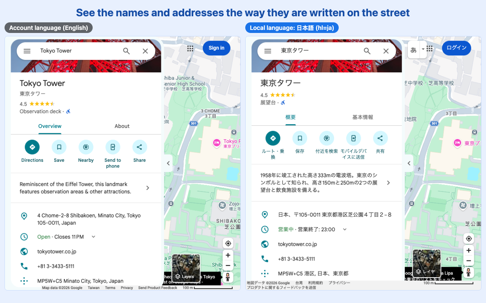

# Maps Language Override

A Chrome extension that shows Google Maps in the language **you** pick, typically the local language of where you are, instead of the language forced by your Google Account.



## Why

When you are signed in, Google Maps always uses your Google Account language. Abroad, that gets in the way:

- **Place names don't match the street.** Names of shops, stations and streets are translated or transliterated, so you can't match them against the signs in front of you.
- **Addresses are rewritten.** You get `4 Chome-2-8 Shibakoen, Minato City, Tokyo` instead of `〒105-0011 東京都港区芝公園４丁目２−８`. The local form is the one you need for a taxi driver, a delivery form, a local app or a building's signboard.
- **The real local text is hard to find.** Machine-translated names, menus and reviews are often awkward, and the original is hidden.

You don't want to change your whole Google Account language for one trip. This extension adds `hl=<language>` to every Google Maps page load, which Google Maps honors over the account setting. Pick a language once and leave it on for the trip, then switch it **Off** when you're home.

## Use

1. Click the toolbar icon.
2. Search for and click a language (all 74 languages the Google Maps website supports, shown by native name). For a language that isn't listed, type its code (e.g. `yue`) and click the **Use code "yue"** row.
3. The open Maps tab reloads in that language, and every Maps page after that follows. Hover the icon (or open the popup) to see the active language.
4. Pick **Off** to go back to your account language.

The toolbar icon is active on Google Maps pages and greyed out everywhere else. It works on `www.google.com/maps`, every country domain (`google.co.jp/maps`, `google.com.tw/maps`, …) and `maps.google.*`. Other Google pages are never touched.

## How it works

- `extension/rules.js` builds two [declarativeNetRequest](https://developer.chrome.com/docs/extensions/reference/api/declarativeNetRequest) dynamic rules for main-frame Maps requests:
  - A `redirect` rule that adds or replaces `hl=<code>`.
  - A higher-priority `allow` rule for URLs that already carry that `hl`, which prevents redirect loops.
- `extension/settings.js` stores the choice in `chrome.storage.sync` and applies the rules and the icon tooltip. `extension/background.js` re-applies them on install, on startup and on sync changes.
- The icon is enabled only on Google Maps tabs and greyed out everywhere else (`chrome.action.enable/disable` per tab).
- There is no content script and no page access, analytics or remote code. See [PRIVACY.md](PRIVACY.md).

## Develop

```sh
npm install
npm test            # unit tests (rules, URL rewriting, manifest)
npm run test:e2e    # real Google Maps in Chrome for Testing with the extension loaded
HEADFUL=1 npm run test:e2e   # same, with a visible window
npm run build       # → dist/maps-language-override-v<version>.zip
npm run icons       # extension/icons/icon.svg → PNGs
npm run assets      # store screenshots + promo tile → store/images/
npm run gen:domains # refresh host_permissions from google.com/supported_domains
npm run check:languages  # verify each listed code really changes google.com/maps
```

**Try it in your own Chrome:** open `chrome://extensions`, turn on **Developer mode**, click **Load unpacked** and select the `extension/` folder.

The e2e test uses Puppeteer's Chrome for Testing because branded Google Chrome no longer accepts `--load-extension`.

## Release: push to deploy

`.github/workflows/release.yml` runs on every push to `main`:

1. It reads `version` from `extension/manifest.json`. If the tag `v<version>` already exists, it does nothing.
2. Otherwise it tests, builds the zip, and **uploads and publishes it to the Chrome Web Store**.
3. Then it creates the tag `v<version>` and a GitHub Release with the zip attached.

**To ship an update, bump `version` in `extension/manifest.json` and push.** Each Web Store publish still goes through Google's review, which usually takes hours to a few days.

### One-time setup

The Chrome Web Store needs the first upload and the listing done by hand:

1. Register as a Chrome Web Store developer at <https://chrome.google.com/webstore/devconsole> (one-time US$5 fee).
2. Click **New item** and upload `dist/maps-language-override-v1.0.0.zip`. It is also attached to the `v1.0.0` GitHub Release.
3. Fill in the **Store listing** and **Privacy** tabs from [store/listing.md](store/listing.md), with images from `store/images/`. Then submit for review.
4. Note the **extension ID** (32 letters, shown on the item page) and your **publisher ID** (the ID in the dashboard URL, `…/devconsole/<publisher-id>`).
5. Create API credentials in [Google Cloud Console](https://console.cloud.google.com/):
   1. Create a project (or reuse one) and enable the **Chrome Web Store API**.
   2. **Google Auth Platform → Branding**: set up the consent screen (External, your own email). Then go to **Audience** and click **Publish app**, so the status is **In production**. In "Testing" mode, refresh tokens expire after 7 days.
   3. **Clients → Create client → Desktop app**, then download its JSON file.
6. Get the refresh token and save all five repository secrets in one go:

   ```sh
   npm run setup:store -- ~/Downloads/client_secret_XXXX.json <EXTENSION_ID> <PUBLISHER_ID>
   ```

   This opens Google sign-in in your browser. Pick the account that owns the store item, and accept the warning that the app is unverified, since it's your own app. The script then saves `EXTENSION_ID`, `PUBLISHER_ID`, `CLIENT_ID`, `CLIENT_SECRET` and `REFRESH_TOKEN` with `gh secret set`, without printing any of them.

Until the secrets exist, the release workflow still builds the zip and creates the GitHub Release, and it shows a warning that the store upload was skipped.

## License

MIT
